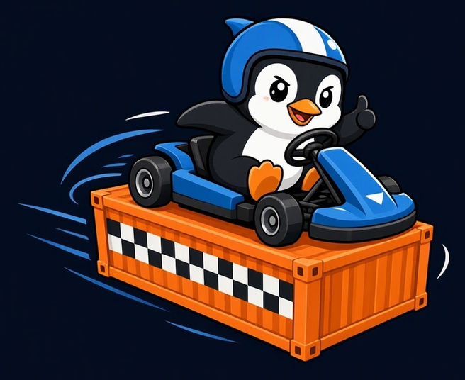

<p align="center">
  
</p>

<p align="center">
  <a href="https://github.com/alfsch/supertuxkart-server/actions/workflows/publish.yaml"></a>
  <a href="https://github.com/alfsch/supertuxkart-server/releases"></a>
  <a href="#interface"></a>
  <a href="#verifying-the-image"></a>
  <a href="https://docs.renovatebot.com"></a>
</p>

# supertuxkart-server

A [SuperTuxKart](https://supertuxkart.net) (STK) dedicated server as a container image for **linux/amd64 and linux/arm64**,
with a bot client that fills a server with AI karts. It is built from the STK sources with `-DSERVER_ONLY=ON`: no graphics,
audio or input stack in the image, and it runs as the non-root user `stk`.
The binary is built as a PIE with the stack protector, `_FORTIFY_SOURCE=2` and full RELRO (`-z relro -z now`), and is stripped; Debian's
GCC enables only PIE by default, so the flags are set in the [Dockerfile](Dockerfile). This covers the STK binary and the libraries
bundled into it (enet, bullet, mcpp), not the Debian packages of the image.

```
ghcr.io/alfsch/supertuxkart-server:latest        newest build
ghcr.io/alfsch/supertuxkart-server:1.5           newest build of STK 1.5
ghcr.io/alfsch/supertuxkart-server:1.5.3         release 3 of STK 1.5, for pinning
ghcr.io/alfsch/supertuxkart-server:1.5-20261122  the build of one day, for pinning
```

Every publish that changes the image takes the next release number of its STK version: `1.5.0`, `1.5.1`, and so on, one above the
highest `1.5.<n>` tag in the registry. Whatever changes the image, for example the automatic merge of a Renovate update of the Debian base
image, is therefore a new patch level, and a new STK version starts again at `.0`. Each release number also gets a
[GitHub release](https://github.com/alfsch/supertuxkart-server/releases) (git tag `v1.5.3`) with the image digest and the
merged PRs since the last release, except the numbers taken by the weekly run: those images have a tag, but no release.

A build that gives the same image as the last release (the same platform image digests as `latest`, which a build-cache hit
does, for example after a change to the README paths or to the workflow itself) publishes nothing: no number, tag, signature or
release. Run the workflow by hand with `force` to release such a build anyway.

Clients and servers of different STK major versions do not play together: use the tag that matches what your players run.

## Verifying the image

Every image published since signing was added is signed keylessly with [cosign](https://github.com/sigstore/cosign)
(Sigstore); the notes of its GitHub release say so. The signature binds the image digest to the publish workflow on `main` of
this repository, so it shows that an image was built by that workflow and not pushed by hand:

```sh
cosign verify ghcr.io/alfsch/supertuxkart-server:latest \
  --certificate-identity https://github.com/alfsch/supertuxkart-server/.github/workflows/publish.yaml@refs/heads/main \
  --certificate-oidc-issuer https://token.actions.githubusercontent.com
```

It works for every tag of a signed release, since they all point at the same signed index; to be safe against a tag being moved, verify and
then run by digest (`ghcr.io/alfsch/supertuxkart-server@sha256:...`, shown in the release notes). Releases made before
signing was added, such as `1.5.0`, are not signed. The identity names the workflow file and the branch: renaming
`publish.yaml` or publishing from another branch changes it. Nothing verifies on pull by itself: Docker and Watchtower do
not check signatures, so a deployment that wants this has to run the command (or an admission policy) itself.

## SBOM

Every image published since the SBOM was added carries a software bill of materials, an SPDX attestation that BuildKit
generates at build time and stores in the registry next to the image (for each platform, together with the SLSA provenance):

```sh
docker buildx imagetools inspect ghcr.io/alfsch/supertuxkart-server:1.5 --format '{{json .SBOM}}'
```

It lists the Debian packages of the image. It does not list the libraries compiled into the STK binary (bullet, enet,
mcpp) or the game data. The attestation is not signed by itself; the signature of the image (above) covers the image
index that refers to it.

## Vulnerabilities of the image you run

Every day all release images that are still in the registry are scanned with [Trivy](https://trivy.dev), and the result is shown where you
look for your version:

- **The page of each [GitHub release](https://github.com/alfsch/supertuxkart-server/releases)** has a "Vulnerabilities" block with the
  counts per platform and the date of the scan.
- **[The report](https://github.com/alfsch/supertuxkart-server/blob/scan-reports/README.md)** on the `scan-reports` branch lists every
  release, newest first, with a page per image: package, installed and fixed version, and the CVEs.

Releases that share an image (`1.5.0` to `1.5.4` do) are one row. If you run `:1.5` or `:latest`, you run the newest release at the time you
pulled; `docker image inspect ghcr.io/alfsch/supertuxkart-server:1.5 --format '{{index .RepoDigests 0}}'` gives the digest to find in the
report. The scan counts **fixable HIGH and CRITICAL** vulnerabilities of the **Debian packages**; the libraries compiled into the STK binary
(bullet, enet, mcpp, ...) and the game data are not covered. A finding with a fix goes away with the next image: update to the newest release.

## Quick start

```sh
cp compose.example.yaml compose.yaml    # three servers (race, soccer, battle) with bots; delete what you do not want
docker compose up -d
docker compose ps                       # (healthy) after a few seconds
```

The example runs the containers with a read-only root file system (a tmpfs for `/home/stk`, where STK writes its config and cache),
no capabilities and `no-new-privileges`. A server and bots were tried that way; if you add a mount that STK has to write to, it
needs to be writable too.

## Interface

Everything is set through environment variables; none of it needs a volume. Services use `network_mode: host`: LAN discovery
needs UDP broadcast, and published ports would bypass the host firewall.

| Item | |
|---|---|
| Image | `ghcr.io/alfsch/supertuxkart-server`. Tags `latest`, `<STK_VERSION>`, `<STK_VERSION>-YYYYMMDD`, `<STK_VERSION>.<n>` (the release number). Platforms `linux/amd64`, `linux/arm64`. |
| User | `stk` (not root) |
| Entrypoint | `/usr/local/bin/entrypoint.sh`; it `exec`s STK, so STK is PID 1 and gets the signals (`docker stop` ends it in under a second, exit 0) |
| Mode | `STK_MODE` = `server` or `bots`, required; anything else exits 1 with a message |
| Logs | stdout and stderr (STK also keeps a small log file under `/home/stk/.config`, see Writes) |

### `STK_MODE=server`

| Variable | Default | |
|---|---|---|
| `STK_PORT` | `2759` | game port (UDP) |
| `STK_GAME_MODE` | `normal-race` | `normal-race`, `time-trial`, `soccer`, `ffa`, `ctf` (STK `server-mode` 3, 4, 6, 7, 8). One fixed mode per server. |
| `STK_SERVER_NAME` | `STK Server` | |
| `STK_DIFFICULTY` | `intermediate` | `novice`, `intermediate`, `expert`, `supertux` |
| `STK_MAX_PLAYERS` | `8` | more than 8 can cost performance |
| `STK_SERVER_PASSWORD` | empty | join password, empty for none; `STK_SERVER_PASSWORD_FILE` reads it from a file (a Docker secret) |
| `STK_AI_HANDLING` | `true` | `true`/`false`; see "Bots" |
| `STK_NETWORK` | `lan` | `lan`, or `wan` for the STK online server list |
| `STK_START_DELAY` | `0` | seconds; see "Several servers on one host" |
| `STK_DISCOVERY_PORT` | `2757` | the UDP port the start delay waits for. STK itself always uses 2757. |

Also accepted, beyond the interface: `STK_OWNER_LESS` (`true`: nobody owns the lobby, the game starts by itself),
`STK_MIN_PLAYERS` (`1`: humans needed before the countdown starts; bots do not count with `STK_AI_HANDLING=true`, see "Bots"), `STK_START_COUNTER` (`20`, seconds of countdown), `STK_LAPS_RATIO` (`-1`; above 0 the laps are
max(1, ratio × the track's default)), `STK_CONSOLE` (set to enable STK's network console, which needs `docker run -i`:
without stdin it spins at 100% of a core), and `STK_EXTRA_ARGS` (more flags for the binary, split on whitespace).

**WAN:** `STK_NETWORK=wan` needs a free account on [online.supertuxkart.net](https://online.supertuxkart.net/register.php),
passed as `STK_ONLINE_USER` and `STK_ONLINE_PASSWORD_FILE` (the path of a Docker secret file; there is deliberately no
password variable). The entrypoint saves the login with `--init-user` on every start; the password is on that one
command line for the moment it takes. The router needs a UDP forward of the game port.

**Config:** with `/config/server_config.xml` mounted (read-only is fine) it is used as it is and the server variables above
are ignored, except `STK_START_DELAY` and `STK_DISCOVERY_PORT`; LAN or WAN is then what the file says (`wan-server`). See
[`server_config.xml.example`](server_config.xml.example). Without a mounted file a config is generated per instance from the
variables, under `/home/stk`.

### `STK_MODE=bots`

Runs the STK client as `--connect-now=$STK_SERVER --network-ai=$STK_BOTS`: one connection that carries N AI karts.

| Variable | Default | |
|---|---|---|
| `STK_SERVER` | `127.0.0.1:2759` | `host:port` of the server |
| `STK_BOTS` | `4` | |
| `STK_BOTS_WAIT` | `60` | seconds to wait for a server on this host, see below |

### Health check

`/usr/local/bin/healthcheck.sh PORT [PORT...]` exits 0 only if **PID 1** owns a UDP socket on every given port. It checks
that this container's own STK process holds the port, not just that somebody does: with host networking a plain port check
would pass while another instance holds it. Exit 1 prints `UDP <port> not owned by PID 1`; exit 2 is a usage error. The
image sets no `HEALTHCHECK` itself, since each instance checks different ports. A server is healthy about **1 s** after it
starts (amd64, a desktop CPU); measure on a slower host and leave margin in `start_period`.

```yaml
healthcheck:
  test: ["CMD", "/usr/local/bin/healthcheck.sh", "2757", "2759"]   # discovery + game port
  interval: 15s
  timeout: 5s
  retries: 3
  start_period: 60s
```

### Ports

| Port | Use |
|---|---|
| UDP 2759 | game (`STK_PORT`; one per instance, e.g. 2759, 2760, 2761) |
| UDP 2757 | LAN server discovery (broadcast); fixed in STK, one owner per host |

### Writes

Nothing persistent and no volumes. The generated config and STK's runtime files go under `/home/stk`, in the container layer.
STK also writes a log file there next to stdout: about 3 KB per finished game, so a server racing nonstop writes about 5 MB a
day. A `tmpfs` on `/home/stk/.config` keeps even that off the disk.

## Behaviour worth knowing

### Several servers on one host

Only **one** instance per host can be found in clients' LAN list: every LAN server binds the discovery port 2757, STK has no
fallback port and sets no `SO_REUSEADDR`. The first one to bind it is listed. The others log
`No direct socket available, this server may not be connected by lan network`, but run normally and take direct connections
(`<host-ip>:<port>` in the client's "Enter server address").

Which one gets 2757 should not depend on the start order, which a reboot or a Watchtower recreate scrambles. Give the
instances that should not be discoverable `STK_START_DELAY` (seconds, longer than the discoverable one needs to start): they
wait until 2757 is bound by anyone, at most that long, and log `discovery port 2757 bound after <n>s` or
`timeout after <n>s, starting anyway`. The health check then shows `(unhealthy)` for an instance that has lost 2757.
Docker Compose's `depends_on: condition: service_healthy` only orders `docker compose up`.

### Bots

- **Modes:** the bots join and play to the end of a game in all five modes: normal race, time trial, soccer, free-for-all
  and capture the flag. Soccer, ffa and ctf add server-side fill karts (14, 8 and 14 karts in total with 3 bots).
- **`STK_AI_HANDLING=true` (the default):** according to STK the server removes one bot for every human that joins (not tested
  here), and **a lobby with only bots waits for a human** instead of racing against itself (tested). That is what you want on a
  household server. The countdown starts when `STK_MIN_PLAYERS` humans are in the lobby, so the default of 1 lets one human race
  against the bots; with 2 (the default before 1.5.9) one human waits for ever.
- **Soccer, free-for-all and capture the flag:** with `STK_AI_HANDLING=true` STK keeps the bots out of these modes (only normal
  race and time trial take them), so a game there needs `STK_MIN_PLAYERS` humans. For one human against bots in such a mode use
  `STK_AI_HANDLING=false`.
- **`STK_AI_HANDLING=false`:** the bots start games on their own: with a 10 s countdown a race began 30 s after they joined, so
  with the default `STK_START_COUNTER=20` expect about 40 s.
- **Reaching the server:** STK itself retries four times and then idles, and it keeps idling when its server goes away, so a
  restart policy would never reconnect the bots. For a server on the same host (`127.0.0.1`, `localhost`, `::1`) the
  entrypoint therefore waits up to `STK_BOTS_WAIT` seconds for its UDP socket and exits 1 if it does not show up, and it
  stops the bots when the socket disappears: `restart: unless-stopped` reconnects them (tested, about a second after the
  server stops). A server on another host cannot be probed, so there the bots simply idle if it is not reachable.
- Bots are accepted from the LAN only (loopback and private addresses count) unless `ai-anywhere` is set in a mounted config.

### Pruned game data

The image contains the STK game data, but the files a server never reads are emptied (zero length, not deleted). The build does this
in the [Dockerfile](Dockerfile), right after `cmake --install`:

| | |
|---|---|
| Emptied | every `*.png`, `*.jpg`, `*.ogg`, `*.ttf` and `*.otf` under `/opt/stk/share/supertuxkart/data`, except the kart icons `karts/*/*_icon.png` (3051 files, about 640 MB) |
| Kept | models (`.spm`), XML, scripts (`.as`), music metadata (`.music`), challenges, grand prix files, translations, the kart icons |
| Result | the STK data shrinks from 776 MB to 130 MB, and its compressed layer from 692 MB to 60 MB |

The files are emptied and not removed because STK checks that they exist: in the traced games it looked for 896 PNGs, 105 JPGs, 3 OGGs and
11 fonts, and never opened them. The kart icons stay because the server opens one of them (`karts/tux/tux_icon.png`). This is
about what a *server* reads: the `SERVER_ONLY` build has no graphics, audio or input stack. The license texts and credits do not come from
this directory (the build copies them from the source tree), so they are complete.

**How it was found out.** The server was run under `strace` in five games with bots, one per mode, and every file it touched under
the game data was listed. Use an image from before the pruning (`1.5.7` or older), a game takes about three minutes:

```sh
printf 'FROM ghcr.io/alfsch/supertuxkart-server:1.5.7\nUSER root\nRUN apt-get update && apt-get install -y --no-install-recommends strace\nUSER stk\n' \
  | docker build -t stk-strace -
docker run -d --name trace --cap-add SYS_PTRACE --entrypoint sh \
  -e STK_MODE=server -e STK_GAME_MODE=normal-race -e STK_AI_HANDLING=false -e STK_OWNER_LESS=true \
  -e STK_START_COUNTER=5 -e STK_MIN_PLAYERS=1 -e STK_LAPS_RATIO=0.2 stk-strace \
  -c 'exec strace -f -qq -e trace=openat,open,stat,newfstatat,statx,access,faccessat,faccessat2 -o /tmp/trace.log /usr/local/bin/entrypoint.sh'
docker run -d --network container:trace -e STK_MODE=bots -e STK_SERVER=127.0.0.1:2759 -e STK_BOTS=4 stk-strace
# after about three minutes:
docker stop trace && docker cp trace:/tmp/trace.log .
grep -E 'openat|open\(' trace.log | grep -v ENOENT | grep -oE '/opt/stk/share/supertuxkart/data/[^"]*' | sort -u \
  | grep -oE '\.[a-z0-9]+$' | sort | uniq -c | sort -rn      # files opened, by extension
```

Repeat it for `time-trial`, `soccer`, `ffa` and `ctf`. In the five traced games the server opened `.spm`, `.xml`, `.music`, `.challenge`, `.as`
and `.grandprix` files and one PNG, and no other image, audio or font file.

**Rechecking.** A new STK release can read more: run the trace again on the new image before the `find` in the Dockerfile is
trusted (step 4 of "Updating STK"). `smoke-test.sh` would not notice: a server that fails to decode an emptied file only does so
when a game loads it. To get the full data back, use a release up to `1.5.7`, or remove the `RUN cd ... find ... truncate` step from
the Dockerfile and build the image yourself.

**Limits.** Bots played all five modes on the pruned image as on the full one (same worlds loaded, same games finished, no new
errors). A human client was not tried against the pruned image, and only a few of the 45 tracks were loaded.

## Updating STK

Renovate opens a PR (label `stk-release`, never merged by itself) when STK publishes a new plain release. Merge it only
once your players have the matching client: clients and servers of different major versions do not play together.

1. The PR bumps `ARG STK_VERSION` in the [Dockerfile](Dockerfile) only, so `test.yaml` fails at the checksum step.
2. On the PR branch run `.github/scripts/update-stk-sha.sh` and commit the Dockerfile. It sets `STK_SHA256` to the digest GitHub
   lists for `SuperTuxKart-<version>-src.tar.gz` (releases from 2025 on have one; a release that ships another file name or
   format needs the Dockerfile adjusted first). Compare it with the release page if it matters to you.
3. Update by hand what Renovate does not touch: the release link and the example tags in this README.
4. Trace the new image as described in "Pruned game data": if the server now opens images, audio or fonts, adjust the `find` in the Dockerfile.

A one-off build of another release does not need a PR: `publish.yaml` takes `stk_version` by hand and reads the checksum from
the release.

## Not verified

- Bots leaving as humans join (`STK_AI_HANDLING=true`), and a race started by a human. A human has joined a server on a
  Raspberry Pi (arm64), but these two were not checked. The `SERVER_ONLY` binary cannot be a human client, so CI cannot
  do it either.
- A human client against the pruned image (the human join on the Pi was before the pruning), and all 45 tracks (a few were loaded).
- A WAN server (it needs an STK account).
- arm64 at runtime beyond that: CI builds and smoke-tests it, and a human join worked on a Pi, but the checks above were
  run on amd64.

## Build and test locally

```sh
docker build -t stk-server:local .                   # ~10 minutes for the C++ build on 12 cores, then cached
.github/scripts/test-entrypoint.sh stk-server:local  # variable validation and the generated config, ~30 s, no server started
.github/scripts/smoke-test.sh stk-server:local       # the interface checks, ~20 s
```

The build downloads `SuperTuxKart-<version>-src.tar.gz` from the GitHub release (it contains the game data, the tag archive
does not) and checks its sha256 (`STK_SHA256` in the [Dockerfile](Dockerfile), the digest GitHub lists for that asset). The
image is about **150 MB** of STK data and binary (the first releases had about 890 MB): the build empties the game's images, audio
and fonts, which the server never reads. See "Pruned game data".

The smoke test needs a Docker daemon. On a rootless one, avoid user-defined networks: starting a second container on one
can block for minutes there (the test shares the server's network namespace instead).

## CI

- `publish.yaml`: on a push to `main` that touches the build, weekly (Monday), or by hand with an optional `stk_version`
  (the checksum is then read from the release). Builds natively on amd64 and arm64 runners (no QEMU), pushes by digest,
  merges into the four tags (the release number comes from `.github/scripts/next-patch.sh`) and signs the merged index with
  cosign (keyless; the job has `id-token: write`). It then pulls the result on both architectures, verifies the signature and
  runs the smoke test, and, except for the weekly run, creates the GitHub release `v<release number>` (the only job with
  `contents: write`). A `compare` job first checks whether the build changed the image at all
  (`.github/scripts/image-unchanged.sh`): if not, tags, signature, smoke test and release are skipped. The weekly run is
  therefore only a scan when nothing changed. The apt layer of the runtime stage is rebuilt once a week (`APT_REFRESH`, the
  ISO week, a build argument of the first publish of each week), so a Debian security update reaches the image even while the
  build cache holds; then the image differs, takes a release number, and, as a weekly run, gets no GitHub release. The same
  happens when GitHub has dropped the cache (after seven days unused). A report-only [Trivy](https://trivy.dev) scan of the signed digest runs on both architectures
  (fixable HIGH and CRITICAL vulnerabilities of the Debian packages; the report is in the job summary and never fails the run;
  for an unchanged build it scans the image that is already published). It does not see the libraries bundled in the STK binary
  or the game data.
- `scan.yaml`: every day (05:17 UTC) it scans the image `latest` points at with Trivy, on both architectures, and sends the
  result to GitHub code scanning: the findings are under Security, Code scanning, with a history, and an alert closes by itself
  once a scan no longer finds it. Same scope as the scan above (fixable HIGH and CRITICAL findings of the Debian packages), and it
  never fails the run on findings, only on an error of the scan itself. The Trivy database changes daily, so it finds CVEs filed
  against an image that has not changed; a finding with a fix stays until a new image is built.
- `scan-releases.yaml`: every day (05:47 UTC) it scans every release image that is still in the registry (`release-images.sh` lists them,
  releases with the same image are scanned once) and builds the report of the section above (`scan-report.sh`): a block in the notes of each
  GitHub release and the pages on the `scan-reports` branch, one commit a day. Old images stay out of GitHub code scanning on purpose: their
  alerts could never close. Only its `report` job writes to the repository (`contents: write`: the branch and the release notes). A scan or
  upload error fails the run, findings do not; a missing result is never shown as clean. The grouping and the report have an offline test
  (`test-scan-report.sh`) that runs in every pull request.
- `test.yaml`: on pull requests, builds both architectures without pushing and runs the entrypoint tests and the smoke test. A `lint`
  job runs shellcheck, actionlint and hadolint (settings in `.hadolint.yaml`); it is not a required check.
- `prune.yaml`: weekly, keeps the newest 5 images (by dated tag or release number) and everything younger than 30 days
  (`prune-images.sh`; by hand it is a dry run unless switched off). The newest image carries `latest`, so it always stays and
  the release counter never falls back.
- `renovate.json`: pins the Debian base image by digest and merges its digest, minor and patch updates itself once
  `test.yaml` passes. A new Debian release and every new STK release are left for a manual merge (see "Updating STK").
  GitHub Actions are pinned by digest with the version in a comment (`uses: owner/repo@<sha> # v1.2.3`); every update of one,
  major ones too, merges itself once the release is three days old and `test.yaml` passes (Renovate does that merge, because
  GitHub's auto-merge would not wait for the age check). `test.yaml` does not run the steps only the publish workflow has
  (signing, scan, release), so a bad update of those shows in the publish run after the merge. This repository's own image
  in `compose.example.yaml` is left alone on purpose: it is named by tag, and a digest pin would open a PR after every
  publish and keep the Debian pin from merging itself.

The package is private until it is made public once by hand: GitHub, Packages, supertuxkart-server, Package settings,
Change visibility. Link it to the repository there as well.

## License

The files in this repository (Dockerfile, scripts, workflows, examples) are licensed
under the [MIT License](LICENSE).

The published container image contains [SuperTuxKart](https://supertuxkart.net),
built unmodified from the official source release
[`1.5`](https://github.com/supertuxkart/stk-code/releases/tag/1.5). Only the installed game data is pruned: the image, audio and
font files of the game are emptied (see "Pruned game data"), because the server does not use them. The image therefore
does not contain those assets, only the license texts, credits and the data the server reads:

- SuperTuxKart's code is licensed under the **GNU GPL v3.0 or later**.
- Its game data (tracks, karts, music, textures) is under various free licenses,
  mostly Creative Commons (e.g. CC-BY-SA).

The image ships the upstream license texts under `/opt/stk/share/doc/supertuxkart/` (the GPL, the credits and the license
file of each asset), and this repository's MIT license under `/opt/stk/share/doc/supertuxkart-server/LICENSE`.
The corresponding source is the upstream release above, verified by the SHA-256 in
the [Dockerfile](Dockerfile), plus the build scripts in this repository. When `STK_VERSION` changes, `STK_SHA256` (see "Updating STK") and
this link change with it. This is the maintainer's working assumption, not legal advice.

The logo ([`docs/logo/logo.png`](docs/logo/logo.png), cropped from [`logo-original.jpg`](docs/logo/logo-original.jpg); the prompt is in
[`docs/logo/PROMPT.md`](docs/logo/PROMPT.md)) was generated with Microsoft's Bing
Image Creator and uses no artwork of SuperTuxKart. This is an unofficial image: it is not made, endorsed or supported by the
SuperTuxKart project, whose name is used here only to say which software the image contains.
